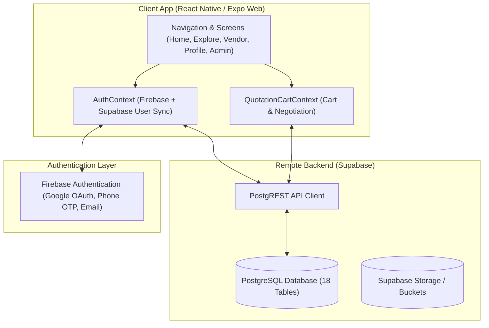
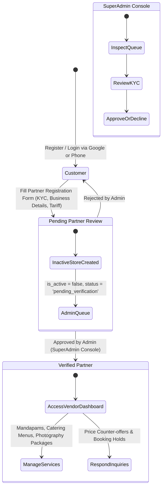

# UtsavHub — Master Developer Prompt & System Specification

> **Target Audience**: Incoming Software Engineers, AI Coding Agents, and Technical Architects.  
> **Repository**: [https://github.com/utsavhub-org/utsavhub-v1.0.git](https://github.com/utsavhub-org/utsavhub-v1.0.git) (`main` branch)  
> **Primary Stack**: React Native (Expo SDK 52) · TypeScript · Supabase (PostgreSQL) · Firebase Auth · Expo Web

---

## 1. Executive Summary & Purpose of the App

**UtsavHub** is a hyper-local, end-to-end wedding, celebration, and event marketplace platform designed specifically for Andhra Pradesh and South India (headquartered in Visakhapatnam / Vizag). 

### The Problem It Solves
Traditional Indian wedding planning is plagued by opaque pricing, hidden middleman commissions (15–30%), date poaching, and chaotic coordination across fragmented service vendors. Families must physically travel to multiple kalyana mandapams, decorators, and caterers to discover availability on auspicious Hindu wedding dates (*Muhurtham*).

### The UtsavHub Solution
1. **Direct-from-Source Verification**: Eliminates intermediaries by connecting families directly to hall owners, caterers, decorators, photographers, and sound technicians.
2. **Muhurtham Calendar Engine**: Real-time Telugu Panchangam integration highlighting Swati, Rohini, and Anuradha muhurtham dates with live date-hold locking to prevent double bookings.
3. **Transparent Tariff & Quotation Cart**: Customers can select individual offerings (e.g. Sangeeth stage, floral mandapam, chairs/coolers, or customize catering menu items with per-plate pricing and minimum guest requirements), bundle them into a quotation cart, and request binding quotes.
4. **Partner Gatekeeping & KYC**: Strict platform administrator audit workflow where vendors must pass Aadhaar/PAN KYC verification before their store appears live on public feeds or before they can access the vendor dashboard.

---

## 2. Technical Stack & Architectural Overview

- **Frontend Framework**: Expo SDK 52 (`react-native` 0.76.x, `react-native-web`) with React 18.
- **Styling & Theme**: Obsidian (`#0B0B0E`), Charcoal (`#15151A`), and Royal Gold (`#D4AF37`, `#F59E0B`) luxury Indian wedding palette. Typography powered by Google's **Plus Jakarta Sans**.
- **Backend & Storage**: 
  - **Supabase**: Hosted PostgreSQL instance (`https://dckmxhqpextqzoreogva.supabase.co`).
  - **Data Integrity**: **100% live server data**. All mock fallbacks have been removed. If a store is not marked `is_active: true` in Supabase, it will not appear on public screens.
- **Authentication**:
  - Firebase Authentication provides Google Sign-In and Phone OTP.
  - User records are automatically synced with the PostgreSQL `user_profiles` table using the Firebase UID as primary key.

---

## 3. Core Roles & State Machine

The platform recognizes three distinct user roles (`UserRole`):

### 1. `customer`
- Can search venues and vendors filtered by **City**, **Muhurtham Date**, **Guest Capacity**, and **Service Category** (AC Halls, Decor, Catering, Photography, DJ & Sound).
- Can inspect itemized details, review photo galleries, and add offerings to their **Quotation Cart**.
- Can submit formal booking inquiries and contact vendors directly via verified phone or WhatsApp.

### 2. `vendor` (Pending Verification)
- Customer submits the **Become a Partner** multi-step registration (Business name, Category, Locality, Phone, KYC ID proof, Starting tariff).
- The system inserts a record in `businesses` with `is_active = false` and updates `user_profiles` with `vendor_application_status = 'pending_verification'`.
- **Gatekeeping**: The user cannot access the Vendor Dashboard. When navigating to Profile, an "Application Under Review" banner is displayed alongside a direct phone link to the UtsavHub Partner Onboarding Team.

### 3. `admin`
- Can log in via the `Platform Admin Portal` button or AuthModal admin role switcher.
- Accesses `src/screens/AdminDashboardScreen.tsx` with live platform metrics: **Pending Audit**, **Active Stores**, and **Database Total**.
- Reviews pending partner applications, inspects masked Aadhaar KYC, and clicks **"✓ Verify & Approve Partner"** or **"Decline"**.
- Approving activates the store in Supabase (`is_active = true`), elevates the applicant's role to `'vendor'`, and grants immediate access to the **Vendor Dashboard**.

### 4. `vendor` (Verified Partner)
- Accesses `src/screens/VendorDashboardScreen.tsx`.
- Manages business specifications:
  - **Decorators**: Mandapams, Sangeeth stages, entrance wayworks, utility rentals (chairs, tents, coolers).
  - **Caterers**: Meal plans, itemized dishes with names, price-per-plate, and minimum guest thresholds.
  - **Function Halls**: AC specs, seating/floating capacities, parking slots, generator backup, and room counts.
  - **Photographers & DJ/Sound**: Tiered packages (Standard, 4K Drone, Cinematic, Wedding Teaser, Audio wattage).

---

## 4. Key Screens & Source Code Architecture

| Screen / Component | File Path | Description |
| :--- | :--- | :--- |
| **App Entry Point** | `App.tsx` | Root navigation provider, Auth provider, Cart provider, font loading, bottom tab bar. |
| **Home Screen** | `src/screens/HomeScreen.tsx` | Hero search bar, Muhurtham date selector, category carousel, featured venues, and verified badges. |
| **Explore / Directory** | `src/screens/ListingsScreen.tsx` | Live search directory. Filters by date, capacity, category, AC status, and outside catering rules. |
| **Vendor Detail Screen** | `src/screens/VendorDetailScreen.tsx` | Comprehensive profile showing 360 photo galleries, hall specifications, catering menus, itemized pricing, reviews, and booking inquiry triggers. |
| **Quotation Cart Modal** | `src/components/QuotationCartModal.tsx` | Slide-up cart allowing users to aggregate items across services, calculate estimated totals, and dispatch quotation requests. |
| **Admin Dashboard** | `src/screens/AdminDashboardScreen.tsx` | SuperAdmin console with partner KYC verification, approval/decline triggers, and live store management. |
| **Vendor Dashboard** | `src/screens/VendorDashboardScreen.tsx` | Partner management portal for offerings, pricing updates, booking calendar holds, and customer inquiry chats. |
| **Vendor Registration** | `src/screens/VendorRegistrationScreen.tsx` | KYC onboarding wizard with Aadhaar/PAN collection, business categorisation, and portfolio image upload. |
| **Profile Screen** | `src/screens/ProfileScreen.tsx` | Customer profile management, role switcher, application status banner, and Admin portal launcher. |
| **Data Layer (Supabase)** | `src/lib/supabaseClient.ts` | Primary client library for queries, mutations, relation mapping, and zero-mock enforcement. |

---

## 5. Database Schema (Supabase PostgreSQL)

The platform is backed by 18 relational tables defined in `supabase/FULL_DATABASE_SETUP_AND_SEED.sql`:

1. **`vendors`**: Vendor entity details (primary contact, phone, WhatsApp, email, city, rating average, KYC verification status).
2. **`businesses`**: Commercial listings linked to a vendor (`name`, `category`, `cover_image_url`, `gallery_images`, `is_active`, `display_order`).
3. **`venue_details`**: Specific attributes for function halls and kalyana mandapams (`seating_capacity`, `floating_capacity`, `is_ac`, `ac_rooms_count`, `parking_cars`, `outside_catering_allowed`, `base_rental_price`, `power_backup_kva`).
4. **`decor_items`**: Event decor offerings (`item_type`: mandapam, sangeeth_stage, waywork, utilities; `title`, `base_price`, `dimensions`, `setup_time_hours`).
5. **`catering_packages`**: Pre-configured menu packages (`package_type`: standard_veg, royal_muhurtham, non_veg_grand; `price_per_plate`, `min_guests`, `welcome_drinks_count`, `sweets_count`, `live_counters_count`).
6. **`catering_items`**: Individual dishes with cuisine classifications (`starters`, `main_course`, `sweets`, `beverages`).
7. **`catering_addons`**: Live counters, dessert bars, and bespoke culinary stations.
8. **`photography_packages`**: Photography and videography offerings (`tier`: standard, premium, cinematic; deliverables, drone 4K inclusions).
9. **`dj_sound_packages`**: Sound, lighting, orchestra, and DJ setups (`power_output_watts`, equipment highlights).
10. **`media_reels`**: 15–30 second vertical video clips showcasing recent ceremonies and setups.
11. **`reel_comments`**: User engagement and comments on media reels.
12. **`booking_inquiries`**: Lead records dispatched by customers to vendors (`muhurtham_date`, `guest_count`, `estimated_budget`, `status`: pending, quotation_sent, date_held, confirmed).
13. **`reviews`**: Customer ratings and verified feedback.
14. **`user_wishlists`**: Saved venues and vendor listings per user.
15. **`support_messages`**: Chat messages and customer support tickets.
16. **`price_update_requests`**: Tariff change proposals submitted by vendors awaiting administrative approval.
17. **`user_profiles`**: Extended profile linked to Firebase Auth UID (`full_name`, `phone`, `email`, `role`, `business_id`, `vendor_application_status`).
18. **`vendor_applications`**: Audit log of submitted vendor registration dossiers.

---

## 6. What Has Been Completed So Far

1. **Strict Zero-Fake-Data Enforcement**:
   - Replaced all in-memory mock datasets in `src/lib/supabaseClient.ts`.
   - Explore and Home screens only query and display live database entities from Supabase where `is_active: true`.
2. **Platform Admin Verification Console**:
   - Built `src/screens/AdminDashboardScreen.tsx` with live KPIs and approval actions.
   - Connected `verifyAndApprovePartner` and `rejectVendorApplication` to mutate Supabase state in real time.
3. **Vendor Registration Gatekeeping**:
   - Customer-submitted applications automatically enter `pending_verification` status with their business marked inactive (`is_active = false`).
   - Unapproved applicants cannot access the Vendor Dashboard and receive clear status feedback with contact options.
4. **Profile Persistence & Clean State**:
   - Fixed Google Auth profile re-prompt bug by restoring cached sessions from `AsyncStorage` immediately on application launch.
   - Removed unnecessary profile fields (wedding date, partner name, redundant link-account buttons).
5. **Quotation Cart System**:
   - Integrated `src/context/QuotationCartContext.tsx` for multi-vendor quote building.

---

## 7. Developer Roadmap & Guidelines for Next Steps

When extending or correcting this application, follow these guidelines:

### A. Deepen the Vendor Dashboard Service Offering Management
- **Requirement**: Allow verified vendors to manage multiple businesses in a stacked card view.
- **Specific Feature**: In `src/screens/VendorDashboardScreen.tsx`, add a dropdown categorized by service type:
  - *Decorators*: Post items categorized as `Mandapams`, `Sangeeth Stages`, `Wayworks / Pathways`, and `Utilities` (chairs, luxury sofas, coolers, misting fans, tents) with photos, dimensions, and base prices.
  - *Caterers*: Add meal plans with itemized dishes (name, description, dietary tag), price per plate, and minimum guest thresholds.
  - *Halls*: Edit hall specifications, AC availability, and parking capacities directly.
- **Persistence**: All added items must insert directly into `decor_items`, `catering_packages`, or `venue_details` in Supabase.

### B. Two-Way Quotation Negotiation & Booking Holds
- **Requirement**: When a customer adds items to their quotation cart and requests a quote, the vendor should receive the request under the **Inquiries** tab in the Vendor Dashboard.
- **Feature**: Enable the vendor to propose a revised counter-offer tariff. If the customer accepts, allow locking the muhurtham date in `booking_inquiries` (`status = 'date_held'`).

### C. Live Real-Time Subscriptions
- Use `supabase.channel('public:booking_inquiries')` to trigger real-time audio and badge notifications when an inquiry is received or an application is approved by the admin.

### D. Architectural Commandments
1. **Never introduce hardcoded mock business arrays** as fallbacks in production screens. Keep the application resilient by showing structured empty states with retry triggers when the network is unavailable.
2. **Always respect the verification gatekeeper**: A user with `role === 'customer'` or `vendor_application_status === 'pending_verification'` must never be routed to the Vendor Dashboard.
3. **Maintain Theme Consistency**: Use the Obsidian and Royal Gold theme constants (`#0B0B0E`, `#15151A`, `#D4AF37`) and Plus Jakarta Sans fonts across all new screens and modals.
