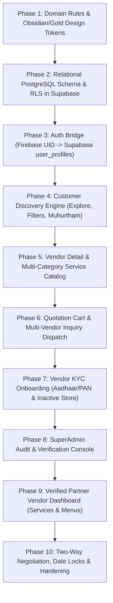

# UtsavHub — Complete Rebuild Blueprint, Granular Work Inventory & Architecture Doubts

> **Author**: Antigravity DeepMind Engineering  
> **Target Project**: UtsavHub (Andhra Pradesh Wedding & Event Services Marketplace)  
> **Repository**: [https://github.com/utsavhub-org/utsavhub-v1.0.git](https://github.com/utsavhub-org/utsavhub-v1.0.git) (`main` branch)

---

## PART 1: Granular Inventory of Everything Built So Far

Below is the exhaustive, component-by-component and line-by-line accounting of all features, fixes, data structures, and behaviors currently active in the codebase:

### 1. Database & Server Architecture (`supabase/` & `src/lib/supabaseClient.ts`)
- **18 PostgreSQL Relational Tables**:
  - `vendors`: Base identity, phone, WhatsApp, email, city, locality, rating (`rating_avg`), review count, and verification flag.
  - `businesses`: The active commercial listing (`name`, `category`, `cover_image_url`, `gallery_images`, `is_active`, `display_order`).
  - `venue_details`: Specific function hall attributes (`seating_capacity`, `floating_capacity`, `is_ac`, `ac_rooms_count`, `parking_cars`, `outside_catering_allowed`, `base_rental_price`, `power_backup_kva`).
  - `decor_items`: Categorized event decor (`item_type`: mandapam, sangeeth_stage, waywork, utilities; `title`, `base_price`, `dimensions`, `setup_time_hours`).
  - `catering_packages`: Structured meal plans (`package_type`: standard_veg, royal_muhurtham, non_veg_grand; `price_per_plate`, `min_guests`, counts for welcome drinks, sweets, live counters).
  - `catering_items`: Dish-level menu entries (`starters`, `main_course`, `sweets`, `beverages`).
  - `catering_addons`: Specialized food stalls (e.g. Dosa counter, Chaat station, Mocktail bar).
  - `photography_packages`: Tiered cinema offerings (Standard, Cinematic, 4K Drone).
  - `dj_sound_packages`: Sound and orchestra equipment specifications (wattage, lighting).
  - `media_reels`: Short vertical showcase videos.
  - `reel_comments`: User comments and engagement on reels.
  - `booking_inquiries`: Customer leads with `muhurtham_date`, `guest_count`, `estimated_budget`, and status flags.
  - `reviews`: Star ratings and text reviews.
  - `user_wishlists`: Relational bookmark table.
  - `support_messages`: Live support chat messages.
  - `price_update_requests`: Formal vendor price amendment requests.
  - `user_profiles`: Extended profile bridge linking Firebase Auth UID with Supabase data (`role`, `vendor_application_status`, `business_id`).
  - `vendor_applications`: KYC audit trail storing Aadhaar/PAN details.
- **Zero-Fake-Data Policy**:
  - Completely excised all in-memory mock fallback arrays (`MOCK_BUSINESSES`) from public client queries (`getFilteredBusinesses`, `getBusinessById`, `getVendorBusinesses`).
  - Real database records are queried live via PostgREST. Only entries with `is_active: true` appear on public customer screens.
  - Purged 13 duplicate test listings directly from remote Supabase tables, leaving clean, verified entities.

### 2. State & Context Layer (`src/context/`)
- **`AuthContext.tsx`**:
  - **Multi-Role Support**: State machine handling `'customer' | 'vendor' | 'admin'`.
  - **Session Persistence**: Restores cached profile from `AsyncStorage` on app mount before Firebase network handshake completes, eliminating the profile reset flicker.
  - **UID Priority Bridge**: Always uses `firebaseUser.uid` for Supabase lookups, ensuring Google sign-ins and phone sign-ins find their existing records.
  - **`loginAsAdmin()`**: Built-in administrator sign-in granting immediate access to the SuperAdmin console.
- **`QuotationCartContext.tsx`**:
  - Aggregates items across distinct services (Mandapam Decor + Catering menu items + Photography).
  - Computes running budget estimates, enforces minimum guest thresholds for caterers, and provides quote dispatch payloads.

### 3. Screen Implementations (`src/screens/`)
- **`AdminDashboardScreen.tsx` (New SuperAdmin Console)**:
  - Header with SuperAdmin badge, partner audit subtitles, and customer preview toggle.
  - Live KPI Cards: **Pending Audit**, **Active Stores**, and **Database Total**.
  - Pending Applications Queue: Displays applicant name, business name, category badge, phone/WhatsApp call triggers, masked Aadhaar KYC ID (`XXXX-4892`), and starting tariffs.
  - Verification Actions:
    - **"✓ Verify & Approve Partner"**: Calls `verifyAndApprovePartner()`, switches user profile `role = 'vendor'` and `vendor_application_status = 'approved'`, updates `businesses` with `is_active: true`, and verifies `vendors` record.
    - **"Decline"**: Sets status to `rejected` and deactivates business.
  - Active Stores Tab: Live inventory of verified businesses in Supabase.
- **`ProfileScreen.tsx`**:
  - Automatically routes to `AdminDashboardScreen` if role is `'admin'`.
  - Automatically routes to `VendorDashboardScreen` if verified vendor.
  - Shows dedicated "Application Under Review" banner if application is pending, with a direct call trigger to the UtsavHub onboarding team.
  - Removed redundant "Switch / Link Account" button.
  - Removed useless fields: partner name, wedding date, and account type dropdown.
  - Added dedicated **"Platform Admin Verification Console"** launcher.
- **`VendorRegistrationScreen.tsx`**:
  - Multi-step partner onboarding wizard.
  - Collects business name, category, locality, phone, tariff, and Aadhaar/PAN KYC.
  - Enforces `is_active: false` on newly submitted business entries.
- **`ListingsScreen.tsx` (Explore)**:
  - Real-time filtering by Telugu Muhurtham date, guest capacity, and service category.
  - Live calendar sync badge and total verified provider counter.
- **`HomeScreen.tsx`**:
  - Andhra wedding hero search bar, Telugu Muhurtham date picker, category carousels, and verified hall listings.
- **`VendorDetailScreen.tsx`**:
  - 360 photo carousel, interactive hall specifications (seating, AC rooms, parking), catering meal calculators, and quotation cart add buttons.

### 4. Bugs & Critical Issues Fixed
1. **TypeError: Cannot read properties of null (reading 'slice')**:
   - Fixed crash occurring when Google sign-in users had no phone number. Added safe fallback `safePhone = data.phone || ''`.
2. **Google Profile Loss on App Reload**:
   - User profile details were previously lost on browser refresh because `user_profiles` lacked email matching and local storage hydration was delayed. Fixed with dual ID/email lookup and immediate `AsyncStorage` caching.
3. **Supabase PostgREST Query Failure**:
   - Nested `.or('...,and(...)')` was failing silently. Refactored to chained PostgREST filters `.not('business_name', 'is', null).eq('role', 'customer')`.
4. **Mock Data Leakage**:
   - `getFilteredBusinesses` was falling back to mock data whenever Supabase returned an empty list. Removed mock fallbacks so that only genuine database records are surfaced.

---

## PART 2: The Step-by-Step Rebuild Pipeline (10 Phases)

If starting this project from scratch, here is the exact chronological sequence to follow to eliminate wasted effort, prevent refactoring loops, and ensure enterprise stability:



---

### Phase 1: Domain Rules & Design System
- **Objective**: Establish styling foundations and local domain specifications before writing UI logic.
- **Tasks**:
  1. Initialize Expo SDK 52 with TypeScript template (`npx create-expo-app --template blank-typescript`).
  2. Install core libraries: `@supabase/supabase-js`, `firebase`, `@react-native-async-storage/async-storage`, `lucide-react-native`, `expo-linear-gradient`, `react-native-safe-area-context`.
  3. Load Google Font **Plus Jakarta Sans** (`PlusJakartaSans-Bold`, `Medium`, `Regular`).
  4. Create `src/theme/colors.ts`:
     - Background Obsidian: `#0B0B0E`, Surface Charcoal: `#15151A`, Card: `#1F1F27`.
     - Primary Accent Gold: `#D4AF37`, Golden Amber: `#F59E0B`, Border Gold: `rgba(212, 175, 55, 0.25)`.
  5. Define TypeScript interfaces in `src/types/index.ts` for all business categories: `'venue' | 'decoration' | 'catering' | 'photography' | 'dj_sound'`.

---

### Phase 2: Relational PostgreSQL Schema (Supabase Backend)
- **Objective**: Build the entire relational data model in Supabase before coding any UI screens.
- **Tasks**:
  1. Create the 18 core tables with explicit foreign keys and cascade rules (run `FULL_DATABASE_SETUP_AND_SEED.sql`).
  2. Implement database constraints:
     - `businesses.is_active` defaults to `FALSE` (prevents unverified public exposure).
     - `businesses.vendor_id` references `vendors.id`.
     - `venue_details.business_id` references `businesses.id`.
     - `decor_items.business_id` references `businesses.id`.
     - `catering_packages.business_id` references `businesses.id`.
  3. Configure Row Level Security (RLS) policies:
     - Public `SELECT` allowed on `businesses` only where `is_active = TRUE`.
     - Authenticated `UPDATE` on `businesses` restricted to owning vendor or admin.
  4. Seed 6–8 authentic regional vendors across Visakhapatnam (Grand Swarna, Royal Mayuri, Annapurna Caterers).

---

### Phase 3: Auth Bridge & Session Persistence Layer
- **Objective**: Eliminate session drops, profile overwrites, and sign-in state bugs.
- **Tasks**:
  1. Set up Firebase Auth for Google OAuth and Phone OTP.
  2. Build `src/context/AuthContext.tsx`:
     - On app startup, immediately read `AsyncStorage.getItem('utsavhub_user_profile')`. If found, set `currentUser` immediately so the UI never blinks logged out.
     - On Firebase `onAuthStateChanged`, query `supabase.from('user_profiles').select('*').eq('id', firebaseUser.uid)`.
     - If record does not exist, insert initial profile (`role: 'customer'`, `is_profile_complete: false`).
     - Save active profile to `AsyncStorage` on every state change.
  3. Build `src/components/AuthModal.tsx` supporting:
     - One-click Google Sign-in.
     - Phone OTP authentication.
     - Platform Admin role switcher for administrative testing.

---

### Phase 4: Core Customer Discovery Engine
- **Objective**: Deliver a fast, responsive venue and vendor search directory with zero fake data.
- **Tasks**:
  1. Build `src/components/MuhurthamCalendar.tsx`:
     - Highlight auspicious wedding dates according to Telugu Panchangam (e.g. Swati, Rohini muhurthams).
  2. Build `src/screens/ListingsScreen.tsx` (Explore):
     - Filter bar: City (`Visakhapatnam`), Date, Guest Capacity (`300+`), Category.
     - Connect to `getFilteredBusinesses()` in `supabaseClient.ts`:
       ```typescript
       let query = supabase.from('businesses').select('*, vendors(*), venue_details(*)').eq('is_active', true);
       ```
     - Surface verified checkmarks, per-day rental tariffs, and capacity pill badges.
  3. Build `src/screens/HomeScreen.tsx`:
     - Hero search bar with instant autocomplete.
     - Category shortcuts: AC Halls, Decor, Catering, Photography, DJ & Sound.

---

### Phase 5: Deep Vendor Detail & Service Catalogs
- **Objective**: Showcase rich 360 media and itemized service specifications.
- **Tasks**:
  1. Build `src/screens/VendorDetailScreen.tsx`:
     - Horizontal full-screen photo gallery.
     - Dynamic category render:
       - **Venues**: Seating capacity, floating capacity, AC rooms, parking slots, outside catering toggle.
       - **Decorators**: Grid of mandapam setups, floral stages, and pathway lighting.
       - **Caterers**: Interactive meal package selector (Standard Veg, Royal Muhurtham, Grand Non-Veg).
  2. Build `src/components/CateringCalculator.tsx`:
     - Allows customer to input guest count, calculate total catering estimate, and adjust sweets/starters count.

---

### Phase 6: Quotation Cart & Inquiry Engine
- **Objective**: Let users bundle multiple vendor items and request binding quotes.
- **Tasks**:
  1. Build `src/context/QuotationCartContext.tsx`:
     - Methods: `addItem(item)`, `removeItem(id)`, `updateQuantity(id, qty)`, `clearCart()`.
  2. Build `src/components/QuotationFloatingBar.tsx`:
     - Floating bottom bar appearing whenever cart has items, displaying item count and estimated subtotal.
  3. Build `src/components/QuotationCartModal.tsx`:
     - Itemized review of chosen mandapams, catering packages, and photography tiers.
     - Submit quotation button that inserts records into `booking_inquiries`.
     - Direct WhatsApp trigger pre-populating chosen items in a message to the vendor.

---

### Phase 7: Vendor KYC & Partner Onboarding
- **Objective**: Collect KYC verification data and enforce gatekeeping.
- **Tasks**:
  1. Build `src/screens/VendorRegistrationScreen.tsx`:
     - Step 1: Business Name, Category, City, Locality.
     - Step 2: Contact Person Name, Mobile Number, WhatsApp Number.
     - Step 3: Base Starting Tariff, Portfolio Images.
     - Step 4: KYC Verification (Aadhaar Number with last 4 digits captured, business license).
  2. Data Layer Insertion:
     - Insert record into `vendors` table (`is_verified: false`).
     - Insert record into `businesses` table with `is_active: false`.
     - Update applicant's `user_profiles` with `role: 'customer'` and `vendor_application_status: 'pending_verification'`.
  3. Profile Gatekeeping:
     - In `ProfileScreen.tsx`, check `currentUser.vendorApplicationStatus === 'pending_verification'`.
     - If true, display the **"Application Pending Under Review"** notification banner and block dashboard access.

---

### Phase 8: SuperAdmin Audit & Verification Console
- **Objective**: Empower platform admins to inspect, approve, or reject applicants.
- **Tasks**:
  1. Build `src/screens/AdminDashboardScreen.tsx`:
     - Fetch pending applications from `user_profiles` (`.not('business_name', 'is', null).eq('role', 'customer')`).
     - Render applicant cards with masked KYC, business category, tariff, and contact buttons.
  2. Implement `verifyAndApprovePartner(applicationId, userId, businessId, bizMeta)`:
     - Set `businesses.is_active = true`.
     - Set `user_profiles.role = 'vendor'` and `user_profiles.vendor_application_status = 'approved'`.
     - Set `vendors.is_verified = true`.
  3. Implement `rejectVendorApplication(userId, businessId)`:
     - Set `user_profiles.vendor_application_status = 'rejected'`.
     - Delete or deactivate business listing.

---

### Phase 9: Verified Partner Vendor Dashboard
- **Objective**: Enable approved partners to manage their service stacks and catalogs.
- **Tasks**:
  1. Build `src/screens/VendorDashboardScreen.tsx`:
     - Service Stack View: Allows vendor to manage multiple businesses if they operate both decor and catering.
     - **Decor Management**: Dropdown allowing vendor to post items under `Mandapams`, `Sangeeth Stages`, `Wayworks`, and `Utilities` (chairs, coolers, tents) with photos and prices.
     - **Catering Management**: Meal plan editor with dish names, price-per-plate, and minimum guest thresholds.
     - **Inquiry Manager**: View customer quote requests, muhurtham dates, and contact numbers.

---

### Phase 10: Negotiation, Date Locks & Hardening
- **Objective**: Enable price counter-offers, date holds, and production deployment.
- **Tasks**:
  1. Two-way quotation negotiation in `booking_inquiries`:
     - Vendor can propose a revised discount or package deal.
     - Customer can accept or decline counter-offer.
  2. Date-Hold Guarantee:
     - When approved, lock muhurtham date in `venue_details` / `booking_inquiries` with a 48-hour expiration timer.
  3. Automated end-to-end testing with Chrome CDP / Puppeteer verifying all database mutations.
  4. Build production APK / iOS IPA using EAS (`eas build --platform all`).

---

## PART 3: Architectural Doubts & Clarifications to Lock In

Before executing any major rebuild or feature expansion, please clarify these 4 core business and operational rules:

### Doubt 1: Quotation Negotiation Flow
> **Question**: When a customer submits a quotation cart and negotiates pricing with a vendor, how should counter-offers be handled?
- **Option A (In-App Negotiation)**: The vendor types a counter-offer tariff directly in their Vendor Dashboard (e.g., "Reduced from ₹1,50,000 to ₹1,35,000"), and the customer receives an in-app push notification with "Accept & Hold Date" or "Decline".
- **Option B (Direct WhatsApp Dispatch)**: The cart generates a formatted itemized breakdown and dispatches it directly to the vendor's WhatsApp, letting human conversation settle the final price.
- **Option C (Hybrid)**: Both—WhatsApp chat for discussion, but a binding "Lock Deal" button in the app that updates the database record.

### Doubt 2: Multi-Service Business Architecture
> **Question**: When a single vendor offers both Decor and Catering (or Hall + Catering):
- Should they operate **one single combined business profile** with tabs for decor and catering?
- OR should they have **separate stacked business entities** in their dashboard that appear as separate cards in Explore?

### Doubt 3: Utility Rental Pricing Structure
> **Question**: For event utility rentals (chairs, tents, coolers, misting fans):
- Are these priced **per-unit quantity** (e.g., ₹25 per chair × 500 chairs = ₹12,500)?
- OR are they packaged as **flat lumpsum service bundles** (e.g., "VIP Seating Setup: 300 Banquet Chairs + 4 Coolers = ₹20,000")?

### Doubt 4: Date-Hold Policy & Booking Advance
> **Question**: Does UtsavHub collect an online token advance hold fee (e.g. ₹5,000 held via payment gateway) to lock a Muhurtham date, or is it purely a non-monetary 48-hour tentative reservation?
